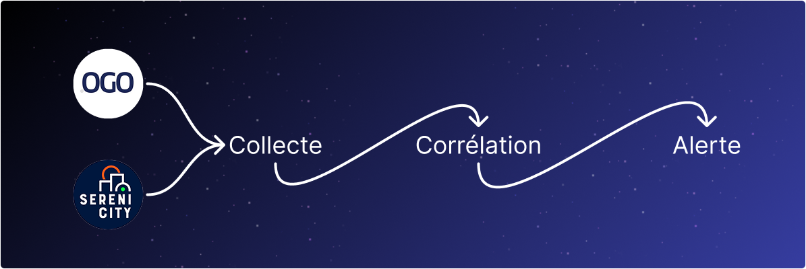
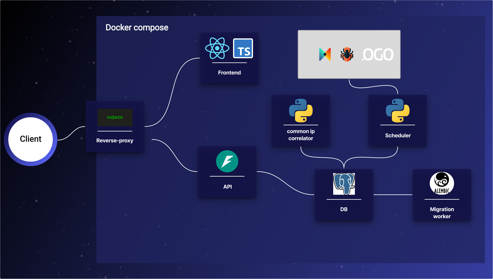

# Cyber Dashboard Deploy

Ce projet contient les fichiers et la documentation nécessaires pour déployer l'application Cyber Dashboard.
Ce README est séparé en 4 parties selon ce que vous souhaitez faire :
  - Avoir un aperçu de l'application et de son architecture
  - Déployer l'application from scratch
  - Sauvegarder PostgreSQL sur un partage NFS
  - Mettre à jour l'application

## Sommaire

- [Présentation de l'application](#présentation-de-lapplication)
  - [Architecture](#architecture)
- [Déploiement from scratch](#déploiement-from-scratch)
  - [Prérequis](#prérequis)
  - [1. Préparer la clé maître](#1-préparer-la-clé-maître)
  - [2. Configurer les variables d'environnement](#2-configurer-les-variables-denvironnement)
  - [3. Préparer HTTPS](#3-préparer-https)
  - [4. Démarrer la stack](#4-démarrer-la-stack)
- [Sauvegardes PostgreSQL sur NFS](#sauvegardes-postgresql-sur-nfs)
  - [Préparer le partage NFS](#préparer-le-partage-nfs)
  - [Fonctionnement du script](#fonctionnement-du-script)
  - [Planifier une sauvegarde tous les quatre jours](#planifier-une-sauvegarde-tous-les-quatre-jours)
  - [Vérifier et restaurer une sauvegarde](#vérifier-et-restaurer-une-sauvegarde)
  - [Tester le script sans infrastructure](#tester-le-script-sans-infrastructure)
- [Mettre à jour l'application](#mettre-à-jour-lapplication)
  - [1. Sauvegarder la base de données](#1-sauvegarder-la-base-de-données)
  - [2. Arrêter la stack](#2-arrêter-la-stack)
  - [3. Récupérer les nouvelles versions et fichiers du dépôt](#3-récupérer-les-nouvelles-versions-et-fichiers-du-dépôt)
  - [4. Mettre à jour le fichier `.env`](#4-mettre-à-jour-le-fichier-env)
  - [5. Télécharger les images et redémarrer](#5-télécharger-les-images-et-redémarrer)
  - [6. Nettoyage des images et conteneurs obsolètes](#6-nettoyage-des-images-et-conteneurs-obsolètes)
- [Vérifier la stack](#vérifier-la-stack)

## Présentation de l'application

Cyber Dashboard sert à détecter si vos différents systèmes 
informatiques supervisés par OGO et serenicity
subissent une attaque commune.

L'application s'organise en 3 axes principaux :

1. **Collecte** : Un scheduler (planifieur) récupère les journaux 
  d'attaques de vos outils de cybersécurité `ogo` et `serenicity`.
2. **Corrélation** : Un corrélateur lit les journaux d'attaques et lève une alerte si une même adresse 
  IP est détectée par des outils différents.
3. **Mise à disposition** : Un dashboard web permet une visualisation de vos données collectées et corrélées.



### Architecture

La stack est composée de plusieurs conteneurs le tout orchestré par Docker Compose, chacun ayant un rôle dédié.

| Service Compose | Rôle |
| --- | --- |
| `db` | Stocke les attaques, les alertes, les sources et la configuration applicative. |
| `migrate` | Exécute les migrations Alembic au démarrage si nécessaire. |
| `api` | Expose l'API utilisée par le frontend. |
| `scheduler` | Réalise des inventaires d'outils de cyber et collecte leurs journaux d'attaques. |
| `common-ip-correlator` | Encapsule une hashmap pour corréler les adresses IP communes entre plusieurs sources. |
| `frontend` | Sert l'interface utilisateur. |
| `reverse-proxy` | Termine le TLS et route le trafic vers le frontend ou l'API. |

Le code source est disponible dans deux dépôts distincts :

| Composant | Dépôt |
| --- | --- |
| Frontend | [cyber-dashboard-frontend](https://github.com/dev-vauclaire/cyber-dashboard-frontend) |
| API, scheduler, corrélateur et migrations | [cyber-dashboard-backend](https://github.com/dev-vauclaire/cyber-dashboard-backend) |



## Déploiement from scratch

Commencez par cloner le dépôt et placez-vous dans le dossier `cyber-dashboard-deploy`.

```bash
git clone https://github.com/dev-vauclaire/cyber-dashboard-deploy.git
cd cyber-dashboard-deploy
```

Toutes les commandes suivantes doivent être exécutées depuis le dossier `cyber-dashboard-deploy`.

### Prérequis

- Un hôte Linux est recommandé.
- Docker Engine et [Docker Compose](https://docs.docker.com/compose/install/linux/) doivent être installés.
- Les ports `80` et `443` doivent être disponibles sur l'hôte.
- Un fichier [`postgres/init.sql`](postgres/init.sql) vide doit être présent.
- Prévoyez au minimum les ressources suivantes pour la stack complète :
  - RAM : 6 Go
  - CPU : 2 vCPU
  - Disque : 32 Go

### 1. Préparer la clé maître

Générez une clé maître et placez-la dans le dossier `secrets` à la racine du projet.
Cette clé est utilisée pour chiffrer les secrets stockés en base de données.

```bash
python3 -c 'import base64, os; print(base64.urlsafe_b64encode(os.urandom(32)).decode())' > secrets/cyber_dashboard_secret_key
chmod 644 secrets/cyber_dashboard_secret_key
```

Vérification de la création de la clé :

```bash
cat secrets/cyber_dashboard_secret_key
```

> ⚠️ Il est recommandé de sauvegarder cette clé dans un coffre-fort sécurisé. La perte de cette clé rendra les secrets stockés en base de données irrécupérables.

> ⚠️ Le fichier `secrets/cyber_dashboard_secret_key` est monté dans les conteneurs via Docker Compose. Le mode `644` permet aux processus non-root des conteneurs de lire le secret. Ne le remplacez pas par `600` sans vérifier l'utilisateur d'exécution des images.

### 2. Configurer les variables d'environnement

Créez le fichier `.env` à partir de l'exemple fourni :

```bash
cp .env.example .env
```

Modifiez ensuite uniquement les variables référencées ci-dessous dans `.env` avec les valeurs de production.

| Variable | Description |
| --- | --- |
| `POSTGRES_USER` | Nom d'utilisateur de la base PostgreSQL |
| `POSTGRES_PASSWORD` | Mot de passe de la base PostgreSQL |
| `POSTGRES_DB` | Nom de la base PostgreSQL |

Permissions recommandées pour le fichier `.env` :

```bash
chmod 600 .env
```

### 3. Préparer HTTPS

Procurez-vous un [certificat TLS](https://aws.amazon.com/fr/what-is/ssl-certificate/) validé par votre autorité de certification
pour votre domaine et placez les fichiers dans le dossier `certs` à la racine du projet.
Nginx attend les fichiers suivants :

```text
certs/fullchain.pem
certs/privkey.pem
```

Si vous souhaitez utiliser un certificat auto-signé, vous pouvez utiliser la commande suivante :

```bash
openssl req -x509 -nodes -days 365 -newkey rsa:2048 -keyout certs/privkey.pem -out certs/fullchain.pem -subj "/CN=localhost"
```

Permissions recommandées :

```bash
chmod 644 certs/fullchain.pem
chmod 600 certs/privkey.pem
```

### 4. Démarrer la stack

```bash
docker compose up -d
```

Depuis une autre machine, vérifiez si le site est accessible
via HTTPS sur le port 443.

```text
https://<ip-de-votre-serveur> ou https://<votre-domaine> si vous avez configuré un nom de domaine.
```

> ⚠️ Pour vérifier que les services tournent correctement : [Vérifier la stack](#vérifier-la-stack).

## Sauvegardes PostgreSQL sur NFS

Le script [`backup/script.sh`](backup/script.sh) exporte la base du service Compose `db`
dans `/mnt/nfs_Qnap/postgresql`. Il conserve les **trois derniers dumps réussis**.
Il s'exécute sur l'hôte Linux et utilise `pg_dump` et `pg_restore` dans le conteneur PostgreSQL 15 :
aucun client PostgreSQL supplémentaire n'est nécessaire sur l'hôte.

### Préparer le partage NFS

Sur l'hôte Debian/Ubuntu, installez le client NFS et créez le point de montage :

```bash
sudo apt-get install nfs-common
sudo mkdir -p /mnt/nfs_Qnap
sudo nano /etc/fstab
```

Ajoutez une seule entrée dans `/etc/fstab`, après avoir remplacé `<IP_DU_NAS>` par
l'adresse du NAS et confirmé le chemin exporté auprès de son administrateur :

```fstab
<IP_DU_NAS>:/BDD_CYBER /mnt/nfs_Qnap nfs nfsvers=4.1,defaults,_netdev 0 0
```

`nfsvers=4.1` choisit la version de NFS ; `defaults` active les options usuelles,
dont le montage automatique ; `_netdev` indique une dépendance au réseau.
Les deux zéros désactivent respectivement l'ancien mécanisme Unix `dump`
(sans rapport avec `pg_dump`) et la vérification locale `fsck`.
Enregistrez avec `Ctrl+O`, Entrée, puis quittez Nano avec `Ctrl+X`.

Rechargez systemd, montez uniquement ce partage et contrôlez son état :

```bash
sudo systemctl daemon-reload
sudo mount /mnt/nfs_Qnap
findmnt --mountpoint /mnt/nfs_Qnap
```

Le NAS doit autoriser l'hôte et permettre l'écriture par l'identité NFS utilisée par
le service de sauvegarde. Le service systemd fourni s'exécute comme `root` ; selon
la configuration du NAS, `root_squash` peut mapper cette identité vers un compte anonyme.
Faites attribuer les droits adaptés côté NAS. Le script refuse un dossier local non monté
ou un montage qui n'est pas de type NFS.

### Fonctionnement du script

Prérequis : Bash, Docker Engine et Compose, `flock`, `mountpoint`, `findmnt`, `realpath`
et les outils GNU usuels. Le service Compose `db` doit être démarré.
Le fichier `.env` est lu par Compose ; le script ne le charge pas comme un script shell
et n'affiche pas son contenu.

Le script suit cet ordre :

1. prendre un verrou local pour empêcher deux sauvegardes simultanées sur cet hôte ;
2. vérifier le montage NFS et l'accès au dossier `postgresql` ;
3. vérifier les archives existantes avec `pg_restore --list` ;
4. exporter PostgreSQL au format `custom` dans un fichier temporaire, puis vérifier sa structure ;
5. publier le fichier par renommage sur le même partage ;
6. supprimer les archives les plus anciennes jusqu'à en conserver trois.

Les noms suivent le format `cyber-dashboard-postgresql_YYYYMMDDTHHMMSSZ.dump`, en UTC.
Seuls les fichiers correspondant à ce nom sont concernés par la rotation ; réservez
ce dossier à cette base et à cet hôte. Les liens symboliques portant ce nom sont refusés.

À J0, J4 et J8, trois dumps sont présents. À J12, celui de J0 est supprimé après la
réussite du nouveau : les trois points de sauvegarde couvrent alors environ huit jours.
Pendant la publication et avant la rotation, quatre archives peuvent exister brièvement.
En cas d'échec d'export ou de validation, aucune archive existante n'est supprimée.
Une archive existante illisible bloque la sauvegarde et doit être examinée avant une nouvelle tentative.

Les nouveaux fichiers sont créés avec des permissions restrictives. Le format `custom`
compresse le dump mais ne le chiffre pas : protégez l'accès au partage et son stockage.
Le dump couvre une seule base, sans les rôles globaux du cluster ni la clé maître de
chiffrement applicative ; cette clé doit être conservée séparément pour permettre une restauration complète.

### Planifier une sauvegarde tous les quatre jours

Les unités versionnées sont dans [`backup/systemd`](backup/systemd).
Le timer lance un contrôle **toutes les heures** ; l'option `--if-due` déclenche un export
si aucun dump n'existe ou si le dernier a au moins **96 heures**.
Le prochain export commence donc de 96 à 97 heures après la publication précédente
lorsque l'hôte et le NAS sont disponibles. La durée de l'export s'ajoute avant publication
du dump suivant, avec une marge supplémentaire possible liée à la charge de la machine.

Cette vérification utilise le nom UTC du dernier dump publié et conserve donc l'échéance
après un redémarrage. `Persistent=true` rattrape un contrôle horaire manqué à la reprise.
Un export en échec est retenté au contrôle suivant. Une date de sauvegarde dans le futur
provoque une erreur explicite. Une expression de jours du mois telle que `*/4` ne garantirait
pas quatre jours d'intervalle aux changements de mois.
Lorsqu'un export n'est pas encore échu, le contrôle horaire ne relit pas le contenu des archives.

Les exemples supposent que le dépôt est installé dans `/opt/cyber-dashboard-deploy`
et que le partage est monté sur `/mnt/nfs_Qnap`.
Depuis la racine du dépôt, installez les fichiers :

```bash
sudo install --owner=root --group=root --mode=0750 \
    backup/script.sh /usr/local/sbin/cyber-dashboard-backup
sudo install --owner=root --group=root --mode=0644 \
    backup/systemd/cyber-dashboard-backup.service /etc/systemd/system/
sudo install --owner=root --group=root --mode=0644 \
    backup/systemd/cyber-dashboard-backup.timer /etc/systemd/system/
```

Adaptez `WorkingDirectory`, `PROJECT_DIR`, `BACKUP_MOUNT` et `RequiresMountsFor` dans
le service si vos chemins diffèrent. Le script, les unités et la configuration du projet
doivent rester modifiables uniquement par des administrateurs de confiance, car le service
dispose de l'accès au démon Docker.

Vérifiez les unités, lancez une première sauvegarde puis activez le timer :

```bash
sudo systemd-analyze verify \
    /etc/systemd/system/cyber-dashboard-backup.service \
    /etc/systemd/system/cyber-dashboard-backup.timer
sudo systemctl daemon-reload
sudo systemctl start cyber-dashboard-backup.service
systemctl show cyber-dashboard-backup.service --property=Result --value
sudo systemctl enable --now cyber-dashboard-backup.timer
systemctl list-timers cyber-dashboard-backup.timer
```

Le résultat attendu du service est `success`. Il est normalement inactif entre les contrôles.
Le timer affiche l'heure du prochain **contrôle**, qui n'entraîne pas nécessairement un export.
Le service exige le montage et limite son exécution à deux heures ; adaptez ce délai si nécessaire.
Le verrou est local à l'hôte, par défaut dans `/run/cyber-dashboard-backup.lock`.

Pour déclencher un dump immédiatement, même avant l'échéance :

```bash
sudo env PROJECT_DIR=/opt/cyber-dashboard-deploy BACKUP_MOUNT=/mnt/nfs_Qnap \
    /usr/local/sbin/cyber-dashboard-backup
```

Une sauvegarde forcée participe à la rotation et reporte la prochaine échéance de 96 heures.
Les erreurs sont signalées avec un code de sortie non nul et une indication de l'étape en échec ;
les sorties brutes de PostgreSQL et de Compose ne sont pas journalisées afin de limiter
l'exposition de la configuration. Consultez le journal du service :

```bash
sudo journalctl -u cyber-dashboard-backup.service
```

Après modification du script ou des unités dans le dépôt, réinstallez les fichiers concernés.
Rechargez systemd après modification des unités et redémarrez le timer si son contenu a changé.
Pour arrêter la planification, utilisez `sudo systemctl disable --now cyber-dashboard-backup.timer` ;
cette commande ne supprime aucune archive.

### Vérifier et restaurer une sauvegarde

`pg_restore --list` vérifie la structure de l'archive ; cela ne remplace pas un test de
restauration. Testez régulièrement un dump dans une base temporaire dédiée, jamais dans
une base contenant des données à conserver.

Depuis la racine du projet, l'exemple suivant utilise une base de test préalablement créée
et autorisée, nommée `cyber_dashboard_restore_test` :

```bash
BACKUP_FILE=/mnt/nfs_Qnap/postgresql/cyber-dashboard-postgresql_YYYYMMDDTHHMMSSZ.dump
docker compose exec -T db pg_restore --list < "$BACKUP_FILE"
docker compose exec -T db sh -ceu '
    [ "$POSTGRES_DB" != cyber_dashboard_restore_test ] || exit 1
    exec pg_restore --exit-on-error --single-transaction --no-owner --no-acl \
        --username="$POSTGRES_USER" --dbname=cyber_dashboard_restore_test
' < "$BACKUP_FILE"
```

Adaptez le nom du dump. La base de test doit être vide et distincte de la base applicative.
Contrôlez ensuite son contenu et le fonctionnement attendu de l'application dans un environnement de test.
Pour une restauration réelle, arrêtez d'abord les services qui écrivent en base et préparez
la configuration ainsi que la clé maître conservées séparément.

### Tester le script sans infrastructure

Les tests utilisent uniquement des fichiers fictifs et des doubles de Docker et NFS ;
ils ne montent aucun partage et ne contactent aucune base :

```bash
bash -n backup/script.sh
python3 -B -m unittest discover -s backup/tests -v
```

Ils vérifient le refus d'un montage absent ou non NFS, la conservation de trois dumps,
les échecs d'export et de validation, l'échéance de 96 heures et le verrou concurrent.
Python 3 est nécessaire uniquement pour ces tests.

## Mettre à jour l'application

### 1. Sauvegarder la base de données

Avant d'arrêter la stack, déclenchez un dump immédiat avec le script installé :

```bash
sudo env PROJECT_DIR="$PWD" BACKUP_MOUNT=/mnt/nfs_Qnap \
    /usr/local/sbin/cyber-dashboard-backup
```

Ne poursuivez pas la mise à jour si cette commande échoue.
La procédure d'installation est décrite dans [Sauvegardes PostgreSQL sur NFS](#sauvegardes-postgresql-sur-nfs).

### 2. Arrêter la stack

```bash
docker compose down
```

### 3. Récupérer les nouvelles versions et fichiers du dépôt

```bash
git pull
```

Cette commande met à jour les fichiers du dépôt, notamment `docker-compose.yaml` et `.env.example`.

### 4. Mettre à jour le fichier `.env`

Comparez votre fichier `.env` avec `.env.example` :

- si de nouvelles variables sont apparues dans `.env.example`, ajoutez-les dans `.env` ;
- si des variables ont été supprimées de `.env.example`, retirez-les de `.env` ;

### 5. Télécharger les images et redémarrer

```bash
docker compose up -d
```

> ⚠️ Le redémarrage de la stack peut prendre quelques minutes, le temps que les migrations s'exécutent.

### 6. Nettoyage des images et conteneurs obsolètes

> ⚠️ Ne la lancer qu'après avoir vérifié que la nouvelle stack fonctionne correctement. [Vérifier la stack](#vérifier-la-stack)

Cette commande supprime les conteneurs arrêtés

```bash
docker container prune
```

Cette commande supprime les images obsolètes

```bash
docker image prune -a
```

## Vérifier la stack

Vérifiez que les services sont bien en statut `Up` avec la commande suivante :

```bash
docker compose ps -a
```

Seul le service de migration devrait être en statut `Exited`.
